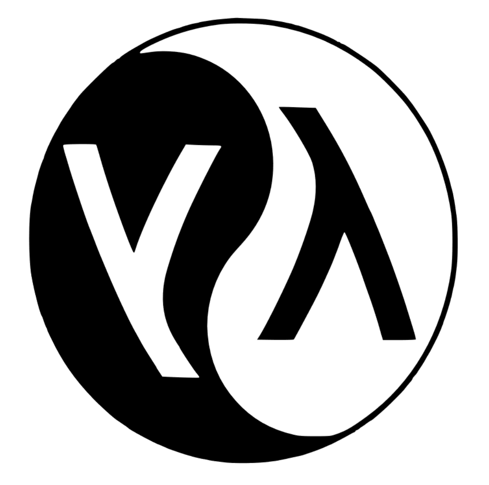

# :VSCLIDE

A full-powered Common Lisp IDE for VS Code.

> **Status:** early development. The extension can start its Lisp side
> and talk to it; IDE features are not built yet.


## Plan

VSCLIDE has two parts:

- **clide**, written in Common Lisp, speaks slynk to a running Lisp and
  serves the extension over JSON-RPC on a loopback socket.
- **jekyl**, written in TypeScript, is the VS Code extension. It starts
  clide and provides the editor-facing features.

The first goal is a slynk-based REPL and the IDE features that build on
it. Later, a Climacs-style arm will add Lisp-side editing support.

You bring your own Lisp implementation. SBCL is the primary target, and
EGCL is supported experimentally.


## Development

See [docs/architecture.md](docs/architecture.md) for the design and
[docs/devops.md](docs/devops.md) for building, running and testing.


## License

```lisp
(defmacro license-terms (system . plist)
  "See LICENSE for the actual legally-binding, non-parenthesized version."
  (declare (optimize (safety 0))) ; use at your own risk
  `(list :system ',system ,@plist))

(license-terms vsclide
  :type        '(:MIT . "https://spdx.org/licenses/MIT.html")
  :permissions '(:use :copy :modify :merge :publish :distribute
                 :sublicense :sell)
  :conditions  '(:include-copyright-notice
                 :include-license-notice)
  :warranty    nil)
```

↳ [LICENSE](LICENSE)

<p align="center">
  
</p>
